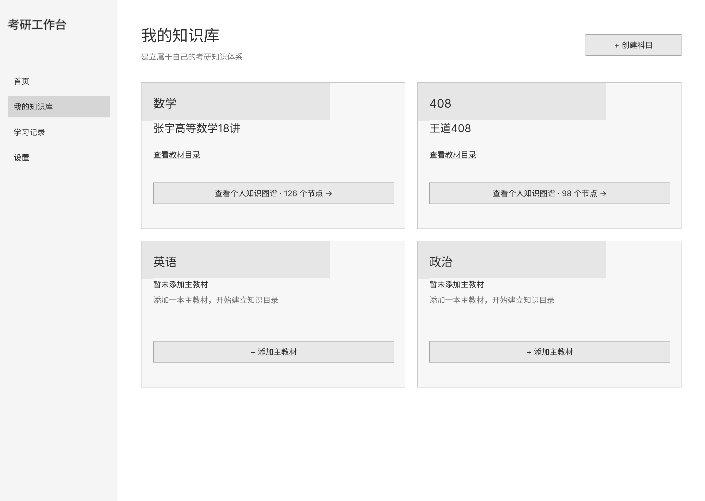
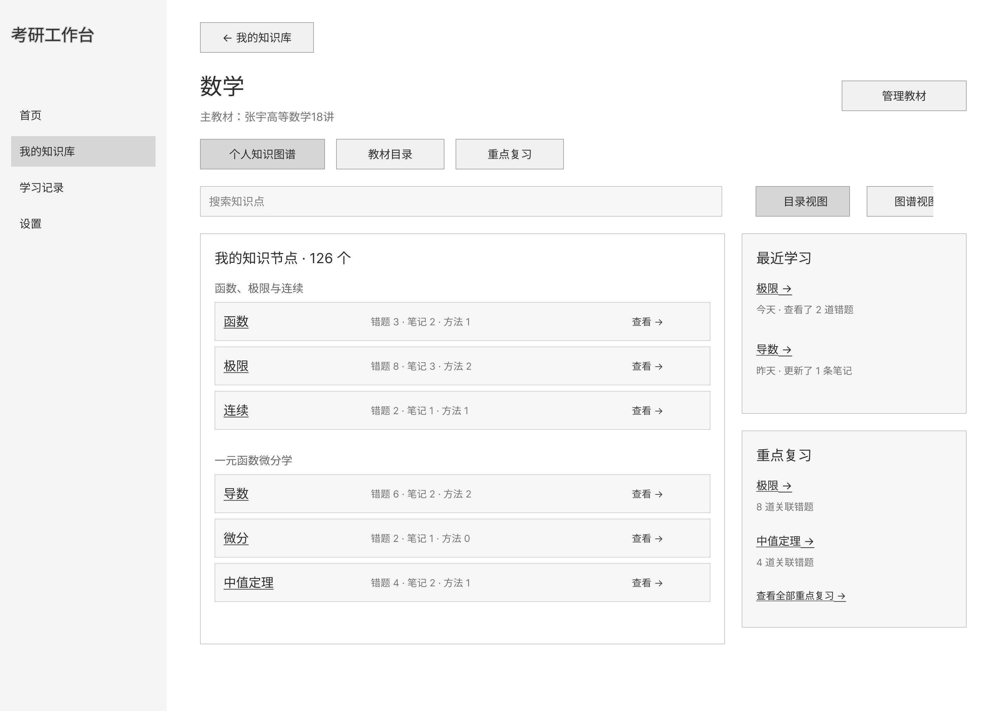
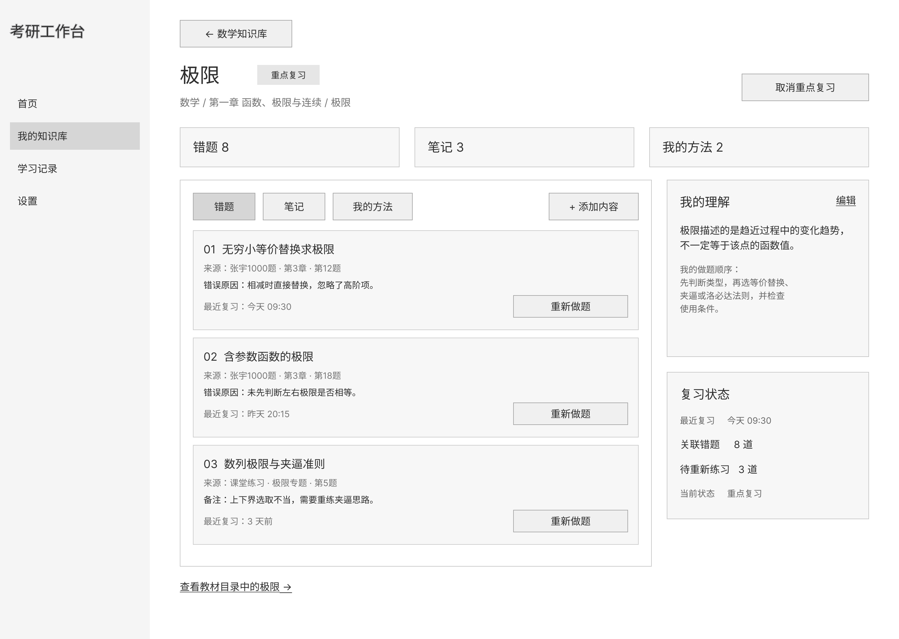

# 产品资料索引

## PRD

[PRD.md](PRD.md) 为持续维护的 Markdown 主文档。Word 文件保留原有名称和内容，统一放在 `prd/`，各版本的差异以文档实际内容为准。

| 文件 | 版本标识（按原文件名） |
| --- | --- |
| [PRD.docx](prd/PRD.docx) | 基础版 |
| [PRD_格式整理版.docx](prd/PRD_格式整理版.docx) | 格式整理版 |
| [PRD_AI产品作品集版.docx](prd/PRD_AI产品作品集版.docx) | AI 产品作品集版 |
| [PRD_正式作品集版.docx](prd/PRD_正式作品集版.docx) | 正式作品集版 |

## 原型图

保留原文件名和图片内容，按知识库、数学、极限的顺序展示。

### 我的知识库

### 数学

### 极限

## 其他素材

根目录原有的两张图标已归档至 [assets/icons](../assets/icons/)。应用使用的图标仍位于 `public/`。
